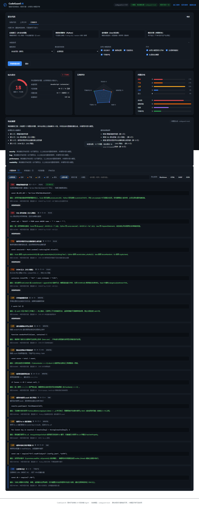
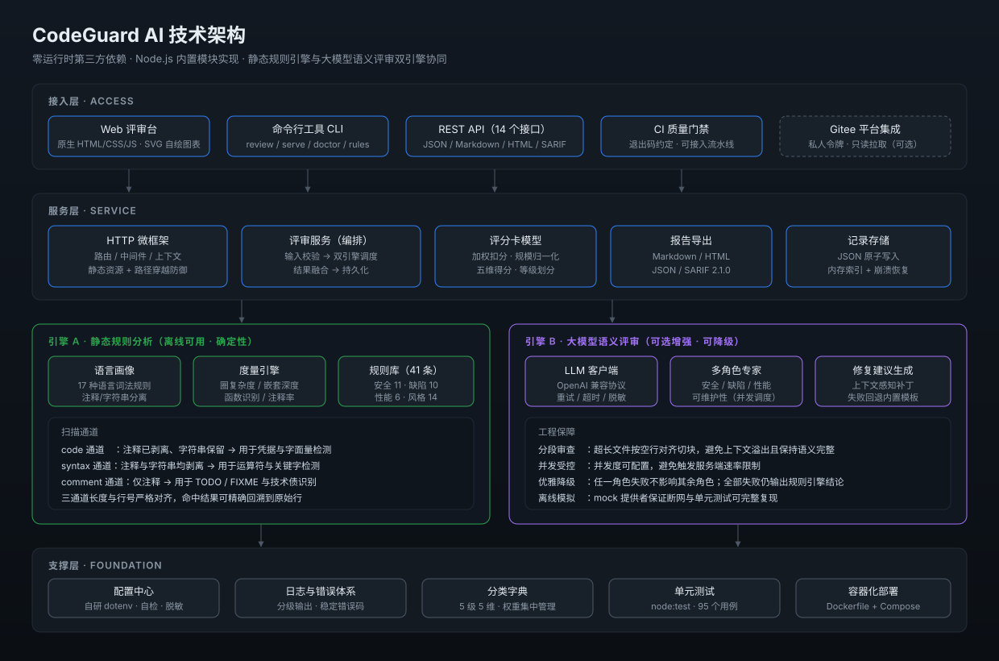
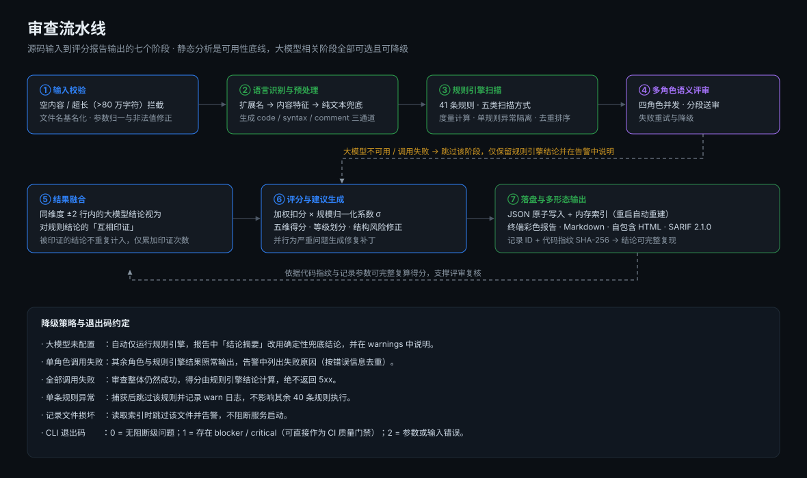
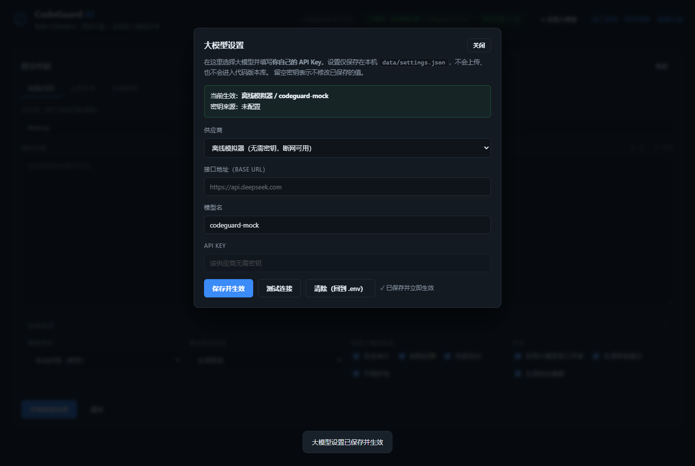

<div align="center">

# CodeGuard AI · 智码审

**面向开发者的 AI 代码审查 Agent**

静态规则引擎 × 多角色大模型语义评审 × 可视化评分报告


</div>

---

## 目录

- [🚀 提交前必读：使用说明](docs/使用说明.md)
- [一、项目介绍](#一项目介绍)
- [二、技术架构](#二技术架构)
- [三、安装与运行](#三安装与运行)
- [四、配置说明](#四配置说明)
- [五、目录结构](#五目录结构)
- [六、测试与验证](#六测试与验证)
- [七、评分模型](#七评分模型)
- [八、常见问题](#八常见问题)
- [九、团队信息](#九团队信息)
- [十、开源许可](#十开源许可)

---

## 一、项目介绍

### 1.1 要解决的问题

代码评审是保障软件质量的最后一道闸门，但团队实践普遍面临三个困境：

| 困境        | 具体表现                                  |
| --------- | ------------------------------------- |
| **人工成本高** | 一次完整评审需要资深工程师投入 30 分钟以上，且随代码量线性增长     |
| **覆盖不稳定** | 评审者注意力随疲劳下降，安全类缺陷（硬编码密钥、SQL 注入）最容易被放行 |
| **结论难沉淀** | 评审意见散落在对话与评论中，无法形成可度量、可追溯、可复现的质量数据    |

### 1.2 解决方案

CodeGuard AI 把代码评审拆解为**可并行的两件事**，各自发挥所长：

- **确定性的事交给规则引擎**：硬编码凭据、SQL 拼接、弱哈希、除零风险、圈复杂度超标等  
  有明确判据的问题，用 41 条规则在本地毫秒级检出，**零成本、零网络依赖、结论 100% 可复现**。
- **语义性的事交给大模型**：越权校验缺失、业务流程缺陷、命名与设计意图不符等需要理解  
  上下文的问题，交由四个专家角色（安全 / 缺陷 / 性能 / 可维护性）并行评审。

两路结论在融合阶段**交叉印证**：当规则引擎与大模型在同一位置、同一维度发现问题时，  
该问题被标记为「双引擎印证」，可信度显著高于任何单一来源。

### 1.3 核心功能

| 功能              | 说明                                                                                       |
| --------------- | ---------------------------------------------------------------------------------------- |
| 🔍 **41 条内置规则** | 安全 11 · 缺陷 10 · 性能 6 · 可读性 7 · 可维护性 7，覆盖 OWASP Top 10 与常见工程缺陷                            |
| 🌐 **17 种语言支持** | JavaScript / TypeScript / Python / Java / Go / C / C++ / C# / PHP / Ruby / Shell / SQL 等 |
| 🤖 **四角色大模型评审** | 每个角色独立提示词与职责边界，降低单次调用需兼顾的维度数量，结论更聚焦                                                      |
| 🔀 **双引擎交叉印证**  | 规则引擎与模型结论自动去重比对，标注互相印证的问题                                                                |
| 📊 **可视化评分报告**  | 综合得分仪表盘、五维雷达图、严重级别分布、代码度量明细                                                              |
| 🛠 **修复建议生成**   | 为严重问题生成上下文感知补丁；大模型不可用时回退到内置修复模板                                                          |
| 📤 **四种报告导出**   | Markdown（贴评论/周报）· HTML（自包含可离线）· JSON（二次处理）· SARIF 2.1.0（接入代码扫描）                          |
| ⚙️ **网页内配置模型** | 评审台「设置」面板即可选择供应商、填写自己的 API Key 并测试连通，无需编辑任何配置文件                                    |
| 💻 **三种使用形态**   | Web 评审台 · 命令行工具 · REST API（18 个接口）                                                       |
| 🚦 **CI 质量门禁**  | CLI 退出码约定：存在阻断/严重问题时返回 1，可直接接入流水线                                                        |
| 🔌 **零依赖离线可用**  | 运行时仅使用 Node.js 内置模块，`npm install` 不下载任何第三方包，断网环境完整可用                                     |

### 1.4 效果预览

**Web 评审台**（粘贴代码 → 一键审查 → 评分卡 + 问题清单 + 修复建议）：



**完整审查报告**：见 [`docs/sample-report.md`](docs/sample-report.md) 与可直接双击打开的  
[`docs/sample-report.html`](docs/sample-report.html)（自包含单文件，无需服务器）。

**命令行一键审查**（以下为真实运行输出，使用 DeepSeek `deepseek-flash`）：

```text
==============================================================================
 CodeGuard AI 代码审查报告   语言 JavaScript   代码指纹 04982f4b6093
==============================================================================

 综合得分 0.3 / 100   等级 D · 不合格   (存在阻断级问题，必须修复后才能合入。)

 维度得分
   安全性　　　 ██████░░░░░░░░░░░░░░  27.6   问题 9 项
   缺陷风险　　 ███████████████░░░░░    75   问题 7 项
   性能　　　　 ███████████████████░  92.7   问题 3 项
   可读性　　　 ████████████████████  98.5   问题 3 项
   可维护性　　 ███████████████████░  96.5   问题 4 项

 严重级别分布
   阻断　　   3 项   单项扣分 15
   严重　　   4 项   单项扣分 10
   主要　　  12 项   单项扣分 5
   次要　　   5 项   单项扣分 2
   建议　　   2 项   单项扣分 0.5

 代码度量
   总行数 96   有效代码 50   注释率 40.5%   函数 6   最大复杂度 2   最大嵌套 3   可维护性 72.6

 审查引擎  规则命中 12 条（40/41 条规则生效）   大模型命中 18 条（4 条互相印证）   耗时 1m20s
 模型      deepseek-flash

------------------------------------------------------------------------------
 问题清单（共 26 项，下表仅列前 8 项）
------------------------------------------------------------------------------

 [阻断] 〔规则〕 L22  SEC001  硬编码敏感凭据
      检测到硬编码凭据（赋值以 “prod_mysql_2026!” 开头），凭据已随源码固化
      │ const DB_PASSWORD = 'prod_mysql_2026!';

 [阻断] 〔规则〕 L32  SEC003  SQL 语句拼接（注入风险）
      SQL 语句存在字符串拼接，应改为参数化查询
      │ const sql = "SELECT * FROM users WHERE name = '" + name + "'";

 [严重] 〔大模型〕 L33  LLM-BUG  db 未声明导致必然抛错
      findUserByName 中使用的 db 在文件内未导入或声明，且文件启用 'use strict'，
      读取未声明标识符会抛 ReferenceError
      │ return db.query(sql);

 [严重] 〔规则〕 L40  SEC005  使用非密码学安全随机数生成凭据
      敏感凭据由伪随机数生成，应改用密码学安全随机源
      │ const sessionId = Math.random().toString(36).slice(2);

 [严重] 〔大模型〕 L94  LLM-SEC  导出不安全 Agent 全局复用
      insecureAgent（rejectUnauthorized:false）被作为模块公开成员导出，作用范围由
      「单个自签内网调用」扩大到「所有 require 本模块的下游代码」
      │ insecureAgent,
```

> 示例中的样本文件 [`examples/vulnerable-sample.js`](examples/vulnerable-sample.js)  
> 是**故意写成充满缺陷**的对照组，因此得分为 0.3（等级 D）属于预期结果。  
> 作为反例，规范实现 [`examples/clean-sample.js`](examples/clean-sample.js)  
> 的审查结果为 **100 分 / 等级 S / 0 个问题**——这份对照用于证明引擎不会误报。

大模型生成的修复补丁（节选自同一次审查）：

```diff
--- a/src/app.js
+++ b/src/app.js
@@ -18,9 +18,17 @@
 const https = require('https');
 const crypto = require('crypto');

-// 凭据直接写入源码 —— 一旦提交即视为泄露
-const DB_PASSWORD = 'prod_mysql_2026!';
-const DB_API_KEY = 'sk-live-…';
+// 凭据通过环境变量/密钥管理服务注入，禁止写入源码
+function requireEnv(name) {
+  const value = process.env[name];
+  if (!value) {
+    throw new Error(`Missing required environment variable: ${name}`);
+  }
+  return value;
+}
+
+const DB_PASSWORD = requireEnv('DB_PASSWORD');
+const DB_API_KEY = requireEnv('DB_API_KEY');

--- a/.env.example
+++ b/.env.example
@@ -0,0 +1,2 @@
+DB_PASSWORD=__REPLACE_ME__
+DB_API_KEY=__REPLACE_ME__
```

---

## 二、技术架构

### 2.1 总体架构



系统分为四层，依赖方向严格自上而下，任一层可独立替换：

| 层次      | 组成                                          | 职责                           |
| ------- | ------------------------------------------- | ---------------------------- |
| **接入层** | Web 评审台 · CLI · REST API · CI 门禁 · Gitee 集成 | 承接用户输入与结果消费，不做业务逻辑           |
| **服务层** | HTTP 微框架 · 评审服务 · 评分卡 · 报告导出 · 记录存储         | 业务编排：校验 → 调度 → 融合 → 计分 → 持久化 |
| **引擎层** | 引擎 A 静态规则分析 · 引擎 B 大模型语义评审                  | 实际的问题检出能力所在，两者物理隔离、可独立降级     |
| **支撑层** | 配置中心 · 日志与错误体系 · 分类字典 · 单元测试 · 容器化          | 横切能力，被上层复用                   |

### 2.2 审查流水线



### 2.3 模块说明

| 模块        | 路径                                 | 职责                                  |
| --------- | ---------------------------------- | ----------------------------------- |
| 配置中心      | `src/config/index.js`              | 自研 dotenv 解析、类型转换、环境自检、密钥脱敏         |
| 日志器       | `src/core/logger.js`               | 分级输出，pretty / json 双格式，ANSI 自动降级    |
| 错误体系      | `src/core/errors.js`               | 统一异常基类与稳定错误码，HTTP 层集中转换为标准响应        |
| HTTP 微框架  | `src/core/http/`                   | 路由器、请求上下文、请求体解析、静态资源（含路径穿越防御）       |
| 分类字典      | `src/core/taxonomy.js`             | 5 级严重程度（含权重）与 5 个审查维度的唯一定义处         |
| 记录存储      | `src/core/storage.js`              | 一记录一 JSON 文件 + 内存索引，临时文件原子重命名写入     |
| 运行时设置    | `src/core/settings-store.js`       | 网页「设置」的持久化：白名单清洗、密钥脱敏、运行时重算配置 |
| 语言画像      | `src/analyzers/languages.js`       | 17 种语言的词法规则，注释 / 字符串 / 语法三通道分离      |
| 度量引擎      | `src/analyzers/metrics.js`         | 圈复杂度、嵌套深度、函数识别、注释率、可维护性指数           |
| 规则库       | `src/analyzers/rules/`             | 41 条规则定义，按维度分为 4 个文件，加载时校验字段合法性     |
| 静态引擎      | `src/analyzers/static-analyzer.js` | 规则调度、消息模板渲染、去重排序、统计汇总               |
| LLM 客户端   | `src/agents/llm-client.js`         | OpenAI 兼容协议、超时中止、指数退避重试、离线模拟器       |
| 提示词模板     | `src/agents/prompt-templates.js`   | 四角色系统提示词与统一输出契约                     |
| 多角色 Agent | `src/agents/review-agent.js`       | 分段切块、并发调度、结果归一化、行号校正                |
| 修复 Agent  | `src/agents/fix-agent.js`          | 补丁生成，含 12 条内置修复模板作为兜底               |
| 评审服务      | `src/services/review-service.js`   | 全流程编排、双引擎融合、降级策略、记录组装               |
| 评分卡       | `src/services/score-service.js`    | 加权扣分模型、规模归一化、维度敏感度、等级划分             |
| 报告导出      | `src/services/report-service.js`   | Markdown / HTML / JSON / SARIF 四种形态 |
| 路由        | `src/routes/`                      | 评审、报告、元信息三组接口，共 14 个端点              |
| 前端        | `web/`                             | 零依赖单页应用，SVG 自绘仪表盘 / 雷达图 / 分布条 / 走势图 |

### 2.4 关键设计决策

**① 运行时零第三方依赖**

后端仅使用 `http`、`fs`、`path`、`crypto` 等 Node.js 内置模块。这个决策带来三个直接收益：

- `npm install` 不下载任何包，**安装成功率 100%**，评委在任意环境都能一键跑通；
- 断网环境（评审现场、内网机房）功能完整可用；
- 不存在第三方包的安全漏洞与版本冲突风险。

代价是需要自行实现路由、dotenv 解析、SVG 图表等基础设施，这些实现已全部配套单元测试。

**② 三通道词法预处理**

规则匹配前把源码拆为三份等长文本，换行与字符偏移严格对齐（因此命中结果可精确回溯原始行）：

| 通道        | 注释     | 字符串    | 典型用途                               |
| --------- | ------ | ------ | ---------------------------------- |
| `code`    | 空格替换   | **保留** | 硬编码凭据、SQL 拼接——必须能看到字面量内容           |
| `syntax`  | 空格替换   | 空格替换   | 松散相等、浮点比较、除零——避免字符串中的 `==` 误报      |
| `comment` | **保留** | 空格替换   | TODO / FIXME 识别——避免注释里的示例代码被当成真实缺陷 |

这一设计解决了纯正则方案的两难：既要能检出字符串里的密钥，又不能被字符串里的运算符干扰。

**③ 大模型全程可选且可降级**

静态分析是可用性底线，大模型相关阶段（语义评审、修复建议、结论摘要）全部按「可选增强」  
处理。任一环节失败都不会导致整体失败：

- 未配置密钥 → 自动仅运行规则引擎，报告中改用确定性兜底结论；
- 单角色调用失败 → 其余角色与规则引擎结果照常输出；
- 全部调用失败 → 审查整体成功，仅规则引擎结论参与计分，**绝不返回 5xx**；
- 单条规则抛异常 → 捕获后跳过该规则，不影响其余 40 条执行。

**④ 结论可复现**

每条记录保存代码指纹（SHA-256）、生效规则数、模型名、规模归一化系数 σ、各维度扣分明细。  
依据这些参数，相同的代码与配置可以完整复算出相同的得分。

### 2.5 技术选型

| 维度    | 选择                            | 理由                                                         |
| ----- | ----------------------------- | ---------------------------------------------------------- |
| 运行时   | Node.js ≥ 18.17               | 内置 `fetch`（无需 axios）、`node:test`（无需 jest）、异步 IO 适合大模型长耗时调用 |
| 语言    | JavaScript（CommonJS）          | 无构建步骤，`node src/server.js` 即可运行，降低评审者复现成本                  |
| 大模型协议 | OpenAI 兼容 `/chat/completions` | 一套客户端适配 DeepSeek、Kimi、火山方舟、Ollama、vLLM 等主流后端               |
| 存储    | JSON 文件 + 内存索引                | 万级记录量级下性能充足，且数据文件人可读、可直接归档                                 |
| 前端    | 原生 HTML/CSS/JS                | 无构建、无 CDN 依赖，离线可用；图表用 SVG 手工绘制                             |
| 测试    | `node:test` + `node:assert`   | 内置模块，无需安装测试框架                                              |

---

## 三、安装与运行

### 3.1 环境要求

| 项       | 要求                           | 说明                         |
| ------- | ---------------------------- | -------------------------- |
| Node.js | **≥ 18.17.0**（推荐 20 LTS 或更高） | 需要内置 `fetch` 与 `node:test` |
| npm     | ≥ 9（可选）                      | 仅用于执行 `npm run` 脚本，非必需     |
| 操作系统    | Windows / Linux / macOS      | 全平台一致，无平台特定代码              |
| 网络      | 可选                           | 仅启用大模型评审时需要；纯规则引擎完全离线      |


检查环境：

```bash
node --version    # 应输出 v18.17.0 或更高
```

### 3.2 快速开始（三步）

```bash
# 第一步：安装（本项目运行时零第三方依赖，此命令不会下载任何包）
npm install

# 第二步：配置环境变量（可选。跳过则仅运行规则引擎，功能完整可用）
cp .env.example .env        # Windows PowerShell: Copy-Item .env.example .env
# 编辑 .env，至少填写 DEEPSEEK_API_KEY

# 第三步：启动
npm start
```

> **Windows 用户看这里（最省事）**：仓库根目录已提供 `start.bat`，
> **双击即可启动**，不必手动敲上面三条命令。脚本会自动检查 Node.js，
> 若未安装会给出官方下载地址；macOS / Linux 仍按上面三步执行。

启动成功后终端会打印访问地址：

```text
  CodeGuard AI  v1.0.0   ·   面向开发者的 AI 代码审查 Agent

  评审台    http://127.0.0.1:8848/
  健康检查  http://127.0.0.1:8848/api/meta/health
  接口清单  http://127.0.0.1:8848/api/meta/routes
  规则清单  http://127.0.0.1:8848/api/meta/rules

  运行环境  development / Node v20.11.0
  大模型    DeepSeek 官方 / deepseek-flash
  数据目录  <项目目录>/data
```

浏览器打开 `http://127.0.0.1:8848/` 即可看到评审台。首次使用建议点击左侧  
「示例样本」载入内置样本，再点「开始智能审查」。

### 3.3 三种使用形态

#### 方式一：Web 评审台（推荐演示）

```bash
npm start
# 浏览器打开 http://127.0.0.1:8848/
```

支持粘贴代码、上传文件（可多选，自动合并为一次审查）、载入内置示例；  
结果区提供维度雷达图、严重级别分布、问题筛选、修复建议 diff、代码度量明细与历史记录。

#### 方式二：命令行

```bash
# 审查单个文件
npm run review -- examples/vulnerable-sample.js

# 审查整个目录（自动跳过 node_modules / .git / dist 等）
npm run review -- src/ --min-severity major

# 仅运行规则引擎（离线、零成本）
npm run review -- examples/vulnerable-sample.js --no-llm

# 与 Git 联动：只审查本次改动
git diff | node bin/codeguard.js review - --no-llm

# 导出报告
npm run review -- app.py --format markdown --out review-report.md
npm run review -- app.py --format html --out review-report.html
npm run review -- app.py --format sarif --out review.sarif.json

# 其他命令
npm run doctor     # 环境自检
npm run rules      # 列出全部 41 条规则（加 --verbose 查看完整说明）
node bin/codeguard.js version
node bin/codeguard.js help
```

**退出码约定**（可直接作为 CI 质量门禁）：

| 退出码 | 含义                        |
| --- | ------------------------- |
| `0` | 无阻断/严重级问题                 |
| `1` | 存在 blocker 或 critical 级问题 |
| `2` | 参数错误或输入为空                 |

#### 方式三：REST API

```bash
# 发起审查
curl -X POST http://127.0.0.1:8848/api/reviews \
  -H "Content-Type: application/json" \
  -d '{
    "code": "const API_KEY = \"sk-abcdef1234567890\";",
    "fileName": "demo.js",
    "useLlm": true
  }'

# 查看历史记录
curl http://127.0.0.1:8848/api/reviews

# 导出 HTML 报告
curl "http://127.0.0.1:8848/api/reviews/<记录ID>/report?format=html" -o report.html
```


完整接口说明见 [`docs/API文档.md`](docs/API文档.md)。运行时可通过
`GET /api/meta/routes` 获取实时接口清单。

### 3.4 Docker 部署

```bash
cd docker
docker compose up -d --build

# 自定义端口与密钥
PORT=9000 DEEPSEEK_API_KEY=sk-xxx docker compose up -d
```

或直接使用 Dockerfile：

```bash
docker build -t codeguard-ai -f docker/Dockerfile .
docker run -d -p 8848:8848 -e DEEPSEEK_API_KEY=sk-xxx --name codeguard codeguard-ai
```

### 3.5 环境自检

部署完成后执行自检，逐项确认环境就绪：

```bash
npm run doctor
```

```text
CodeGuard AI 环境自检  v1.0.0

  ✔ Node.js 版本         v20.11.0（要求 >= 18.17.0）
  ✔ .env 配置文件         /app/.env
  ✔ 大模型连接            DeepSeek 官方 / deepseek-flash（https://api.deepseek.com）
  ✔ 全局 fetch 可用性     内置 fetch 就绪（无需第三方 http 库）
  ✔ 数据目录可写          /app/data

结论：环境就绪，可以启动服务。
```

---

## 四、配置说明

### 4.1 环境变量

完整模板见 [`.env.example`](.env.example)，**`.env` 已被 `.gitignore` 排除，不会进入版本库**。

#### 服务运行参数

| 变量 | 默认值 | 说明 |
| --- | --- | --- |
| `PORT` | `8848` | 监听端口 |
| `HOST` | `127.0.0.1` | 监听地址；演示时改为 `0.0.0.0` 可局域网访问 |
| `NODE_ENV` | `development` | 运行环境标识 |
| `LOG_LEVEL` | `info` | `debug` / `info` / `warn` / `error` |
| `LOG_FORMAT` | `pretty` | `pretty`（带颜色）或 `json`（适合日志采集） |
| `MAX_BODY_BYTES` | `5242880` | 单次请求体上限（字节） |

#### 大模型服务参数

| 变量 | 默认值 | 说明 |
| --- | --- | --- |
| `LLM_PROVIDER` | `deepseek` | `deepseek` / `openai-compatible` / `mock` |
| `DEEPSEEK_API_KEY` | 空 | DeepSeek 密钥，[申请地址](https://platform.deepseek.com/api_keys) |
| `DEEPSEEK_BASE_URL` | `https://api.deepseek.com` | 接口根地址 |
| `DEEPSEEK_MODEL` | `deepseek-flash` | 模型名；可用 `GET /models` 查询账号可用列表 |
| `OPENAI_COMPATIBLE_API_KEY` | 空 | 其他兼容后端的密钥 |
| `OPENAI_COMPATIBLE_BASE_URL` | 空 | 其他兼容后端的接口根地址 |
| `OPENAI_COMPATIBLE_MODEL` | 空 | 其他兼容后端的模型名 |

#### 审查引擎参数

| 变量 | 默认值 | 说明 |
| --- | --- | --- |
| `REVIEW_ENABLE_LLM` | `true` | 关闭后仅运行规则引擎，完全离线 |
| `REVIEW_TEMPERATURE` | `0.2` | 采样温度；代码审查建议 ≤ 0.3 以保证结论稳定 |
| `REVIEW_MAX_TOKENS` | `4096` | 单次调用最大输出 token |
| `REVIEW_CONCURRENCY` | `2` | 大模型并发度，避免触发速率限制 |
| `REVIEW_TIMEOUT_MS` | `120000` | 单次请求超时（毫秒） |
| `REVIEW_MAX_RETRIES` | `2` | 超时与 5xx 的可重试次数 |
| `REVIEW_MAX_LINES` | `1200` | 送审最大行数，超出截断 |
| `REVIEW_CHUNK_LINES` | `400` | 分段送审时每段行数 |

#### 存储与集成

| 变量 | 默认值 | 说明 |
| --- | --- | --- |
| `DATA_DIR` | `data` | 评审记录存放目录 |
| `KEEP_REPORT_FILES` | `true` | 是否保留报告文件 |
| `GITEE_ACCESS_TOKEN` | 空 | Gitee 私人令牌（可选，用于仓库拉取） |
| `GITEE_API_BASE` | `https://gitee.com/api/v5` | Gitee 开放接口地址 |

### 4.2 支持的模型后端

| `LLM_PROVIDER` | 适用场景 | 必要配置 |
| --- | --- | --- |
| `deepseek` | DeepSeek 官方接口 | `DEEPSEEK_API_KEY` |
| `openai-compatible` | 任意兼容 OpenAI 协议的服务 | `OPENAI_COMPATIBLE_API_KEY` + `OPENAI_COMPATIBLE_BASE_URL` + `OPENAI_COMPATIBLE_MODEL` |
| `mock` | 离线演示、单元测试、断网环境 | 无需任何配置 |

### 4.3 网页「设置」面板（推荐给不熟悉命令行的使用者）

评审台右上角提供 **「⚙ 设置大模型」** 按钮，可在页面内完成全部配置：



1. **选择供应商**：DeepSeek 官方 / 任意 OpenAI 兼容后端 / 离线模拟器；
2. **填写自己的 API Key**：保存后**立即生效**，无需重启服务、无需编辑任何文件；
3. **测试连接**：保存前先验证密钥是否可用，失败会给出具体原因；
4. **清除**：一键回到 `.env` 默认值。

**优先级**：页面设置 > `.env` > 内置默认值。页面上未填写的字段会自动沿用 `.env`。

> **安全说明**：页面保存的设置只写入本机 `data/settings.json`。`data/` 已在 `.gitignore` 中，
> 因此密钥**不会进入代码版本库**；接口返回的密钥一律脱敏为 `sk-xxxx****xxxx`，
> 明文只在服务端内存中用于发起请求。

`openai-compatible` 实测可用的后端示例：

| 服务 | `OPENAI_COMPATIBLE_BASE_URL` |
| --- | --- |
| Moonshot Kimi | `https://api.moonshot.cn/v1` |
| 火山方舟 | `https://ark.cn-beijing.volces.com/api/v3` |
| 本地 Ollama | `http://127.0.0.1:11434/v1` |
| 本地 vLLM | `http://127.0.0.1:8000/v1` |

### 4.3 依赖清单

**运行时第三方依赖：无。** 全部能力基于 Node.js 内置模块实现：

| 用途 | 使用的内置模块 |
| --- | --- |
| HTTP 服务 | `http` |
| 文件与路径 | `fs`、`path` |
| 加密与指纹 | `crypto` |
| 网络请求（大模型调用） | 全局 `fetch` |
| 测试框架 | `node:test`、`node:assert` |

因此 `npm install` 不需要访问 npm registry，也不存在依赖漏洞与版本冲突问题。

---

## 五、目录结构

```text
codeguard-ai/
├── bin/
│   └── codeguard.js              # 命令行入口（review / serve / doctor / rules）
├── src/
│   ├── server.js                 # 服务入口与启动横幅
│   ├── config/
│   │   └── index.js              # 配置中心：dotenv 解析、自检、脱敏
│   ├── core/
│   │   ├── taxonomy.js           # 严重级别与审查维度字典
│   │   ├── logger.js             # 分级日志（pretty / json）
│   │   ├── errors.js             # 错误体系与稳定错误码
│   │   ├── utils.js              # 通用工具（并发映射、哈希、转义）
│   │   ├── storage.js            # 评审记录的原子化持久化
│   │   ├── settings-store.js     # 运行时设置（data/settings.json，不入版本库）
│   │   └── http/
│   │       ├── app.js            # 中间件流水线装配
│   │       ├── router.js         # 微型路由器（支持路径参数）
│   │       ├── context.js        # 请求上下文与请求体解析
│   │       └── static-files.js   # 静态资源服务（含路径穿越防御）
│   ├── analyzers/
│   │   ├── index.js              # 分析能力门面
│   │   ├── languages.js          # 17 种语言画像与三通道词法预处理
│   │   ├── metrics.js            # 度量引擎
│   │   ├── static-analyzer.js    # 规则调度与结果组装
│   │   └── rules/
│   │       ├── index.js          # 规则注册表（加载时校验）
│   │       ├── security-rules.js # 安全规则 11 条
│   │       ├── bug-rules.js      # 缺陷规则 10 条
│   │       ├── performance-rules.js # 性能规则 6 条
│   │       └── style-rules.js    # 可读性与可维护性规则 14 条
│   ├── agents/
│   │   ├── llm-client.js         # OpenAI 兼容客户端 + 离线模拟器
│   │   ├── prompt-templates.js   # 四角色提示词与输出契约
│   │   ├── review-agent.js       # 多角色并发评审编排
│   │   └── fix-agent.js          # 修复建议生成（含内置模板兜底）
│   ├── services/
│   │   ├── review-service.js     # 全流程编排与双引擎融合
│   │   ├── score-service.js      # 评分卡模型
│   │   └── report-service.js     # 四种报告格式导出
│   └── routes/
│       ├── index.js              # 路由总装
│       ├── review-routes.js      # 评审接口
│       ├── report-routes.js      # 报告导出接口
│       ├── settings-routes.js    # 运行时设置接口（读/写/连通性测试/清除）
│       └── meta-routes.js        # 元信息接口
├── web/                          # 零依赖前端
│   ├── index.html
│   ├── favicon.svg
│   └── assets/
│       ├── style.css
│       ├── charts.js             # SVG 自绘图表
│       ├── samples.js            # 内置演示样本
│       └── app.js                # 交互逻辑
├── test/                         # 单元与集成测试（107 个用例）
│   ├── languages.test.js
│   ├── metrics.test.js
│   ├── static-analyzer.test.js
│   ├── score-service.test.js
│   ├── llm-client.test.js
│   ├── report-service.test.js
│   ├── review-service.test.js
│   ├── settings.test.js          # 运行时设置：白名单清洗、密钥脱敏、保存即生效
│   └── api.test.js
├── examples/                     # 演示样本
│   ├── vulnerable-sample.js      # 含多处典型缺陷（JS）
│   ├── messy-sample.py           # 含 Python 专有缺陷
│   └── clean-sample.js           # 规范实现（用于验证零误报）
├── docs/
│   ├── 架构设计.md               # 分层结构、四项关键设计决策的论证
│   ├── API文档.md                # 18 个接口的参数、响应与错误码
│   ├── 部署与运行.md             # 本地 / 局域网 / Docker / CI 四种部署路径
│   ├── 环境配置说明.md           # 24 个环境变量逐项说明与依赖清单
│   ├── 测试与验证报告.md         # 测试结果、真实验证数据与 13 项缺陷修复记录
│   ├── 评分标准对齐说明.md       # 逐条映射赛题要求与落点
│   ├── sample-report.md          # 真实审查报告样例（Markdown）
│   ├── sample-report.html        # 自包含 HTML 报告（可直接双击打开）
│   ├── sample-report.json        # 机器可读报告
│   ├── sample-report.sarif.json  # SARIF 2.1.0 报告
│   └── images/
│       ├── architecture.svg      # 技术架构图
│       ├── pipeline.svg          # 审查流水线图
│       ├── screenshot-review.png # 评审台整页截图
│       ├── screenshot-top.png    # 评审台首屏截图
│       ├── screenshot-fixes.png  # 修复建议面板
│       └── screenshot-metrics.png # 代码度量面板
├── docker/
│   ├── Dockerfile                # 多阶段构建、非 root 运行、健康检查
│   └── docker-compose.yml        # 编排、数据卷持久化、日志轮转
├── tools/
│   └── push-to-gitee.ps1         # Gitee 一键推送脚本（含密钥泄漏自检）
├── .workflow/
│   └── codeguard.yml             # Gitee Go 流水线（测试 → 审查 → 归档）
├── .gitee/
│   ├── ISSUE_TEMPLATE/
│   │   └── bug_report.md         # 缺陷报告模板（区分误报与漏报）
│   └── PULL_REQUEST_TEMPLATE.md  # PR 自检清单
├── .env.example                  # 环境变量模板
├── .editorconfig                 # 跨编辑器代码风格
├── .gitignore                    # 排除 node_modules / .env / data
├── package.json                  # 零运行时依赖
├── CHANGELOG.md
├── CONTRIBUTING.md
└── LICENSE                       # MIT
```

---

## 六、测试与验证

### 6.1 运行测试

```bash
npm test
```

```text
ℹ tests 107
ℹ suites 0
ℹ pass 107
ℹ fail 0
ℹ duration_ms 1068.3
```

### 6.2 测试覆盖范围

| 测试文件 | 用例数 | 覆盖内容 |
| --- | ---: | --- |
| `languages.test.js` | 12 | 语言识别、注释剥离保长保行号、字符串中的注释符号、Python 文档字符串、CRLF 兼容 |
| `metrics.test.js` | 11 | 函数识别（含保留字排除与行号校准）、圈复杂度定义、嵌套深度、注释率、可维护性指数单调性 |
| `static-analyzer.test.js` | 16 | 规则注册表完整性、各类规则的实际检出、**干净代码零误报**、去重排序、过滤与统计一致性 |
| `score-service.test.js` | 12 | 满分与等级边界、σ 单调性、扣分闭环可复算、结构风险修正、维度敏感度 |
| `llm-client.test.js` | 13 | 非标准 JSON 容错解析、5xx 重试、401 立即失败、超时中止、思维链截断诊断、离线模拟器确定性 |
| `report-service.test.js` | 6 | 四种格式结构完整性、HTML 自包含与 XSS 转义、SARIF 规范形态 |
| `review-service.test.js` | 14 | 输入校验、双引擎融合与印证统计、降级行为、**离线零大模型调用**、持久化、概览统计 |
| `api.test.js` | 14 | 全部接口的请求-响应链路、400/404/405 错误码、报告下载、静态资源与 304 缓存、路径穿越防御、安全响应头 |

测试中使用**离线模拟器**作为大模型后端，因此整套测试**无需网络、无需密钥、结果确定可复现**。

### 6.3 关键验证结论

1. **零误报约束**：`examples/clean-sample.js`（规范实现）审查结果为 **0 个问题、100 分、等级 S**。
   该样本已被固化为单元测试用例，任何导致误报的改动都会使测试失败。
2. **检出能力**：`examples/vulnerable-sample.js` 在**仅规则引擎**模式下检出 **12 个问题**
   （含 2 个阻断级）；启用大模型后共检出 **26 个问题**，其中大模型独立发现 18 条、
   与规则引擎互相印证 4 条。`examples/messy-sample.py` 检出 **10 个问题**，覆盖全部预期规则。
3. **降级可用性**：关闭大模型、或大模型调用全部失败时，审查仍成功返回规则引擎结论，
   并在告警字段中明确说明。
4. **真实大模型联调**：已使用 DeepSeek `deepseek-flash` 完成端到端调用验证，
   4 个专家角色全部成功返回，token 用量与推理 token 占用均被记录，
   结果见 [`docs/sample-report.md`](docs/sample-report.md)。


---

## 七、评分模型

评分模型完全公开且可复算，避免「拍脑袋打分」：

```text
综合得分 = clamp(100 − σ × Σ(严重级别权重 × 来源可信度), 0, 100)
```

**各项权重**

| 严重级别 | 单项扣分 | 典型问题 |
| --- | ---: | --- |
| blocker 阻断 | 15 | 硬编码凭据、SQL 注入、命令注入 |
| critical 严重 | 10 | 关闭证书校验、不安全随机数、XSS |
| major 主要 | 5 | 松散比较、静默吞异常、除零风险、函数过长 |
| minor 次要 | 2 | 命名不规范、调试输出残留、注释率不足 |
| info 建议 | 0.5 | 待办标记、连续空行、超过 120 字符的行 |

**来源可信度**：静态规则命中 `1.00`（确定性、可复现）；大模型命中 `0.80 × confidence`（概率性推断）。

**规模归一化系数 σ**：`σ = 1 / (1 + ln(max(N, 30) / 30) / 3)`，N 为有效代码行数。

| 代码行数 | 30 | 100 | 500 | 1200 |
| --- | ---: | ---: | ---: | ---: |
| σ | 1.00 | 0.71 | 0.52 | 0.45 |

其作用是抑制「大文件因问题条目多而被系统性低估」的偏差：同样的 3 处缺陷，
出现在 1000 行代码中比出现在 50 行代码中更可接受，这一直觉被 σ 量化。

**维度敏感度**：安全性 1.20 · 缺陷风险 1.00 · 性能 0.90 · 可读性 0.80 · 可维护性 0.80。
安全问题的敏感度最高，因其后果不可逆且修复成本随时间指数上升。

**结构风险修正**：最大圈复杂度超过 15、嵌套深度超过 4 层时施加附加扣分。
「复杂但暂时正确」的代码是未来缺陷的温床，单纯按问题条目计分无法体现。

**等级划分**：S ≥ 92 · A ≥ 82 · B ≥ 70 · C ≥ 60 · D < 60。

---

## 八、常见问题

<details>
<summary><b>没有 API Key 能用吗？</b></summary>

能。不配置 `.env` 时系统仅运行静态规则引擎（41 条规则），功能完整、完全离线。
也可以在页面右上角「⚙ 设置大模型」中选择**离线模拟器**，以离线模拟模式体验含大模型环节的完整流程。
</details>

<details>
<summary><b>想用自己的 API Key，一定要改配置文件吗？</b></summary>

不用。打开评审台后点右上角 **「⚙ 设置大模型」**：选择供应商 → 粘贴密钥 → 点「测试连接」确认可用
→ 点「保存并生效」。**全程不需要编辑任何文件，也不需要重启服务。**

密钥只保存在本机 `data/settings.json`（不进入版本库），接口返回一律脱敏。
</details>

<details>
<summary><b>git push 长时间卡住不动怎么办？</b></summary>

部分网络环境下 git 走 HTTP/2 推送会长时间无响应（表现为 `git push` 无任何输出）。
强制改用 HTTP/1.1 通常可立即恢复正常：

```bash
git -c http.version=HTTP/1.1 push
```

也可写入全局配置一次性解决：

```ini
# ~/.gitconfig
[http]
    version = HTTP/1.1
```

若想快速失败而不是无限等待，可加低速保护：

```bash
git -c http.lowSpeedLimit=1000 -c http.lowSpeedTime=25 push
```
</details>

<details>
<summary><b>npm install 会不会下载很多包？</b></summary>

不会。本项目运行时零第三方依赖，`npm install` 不下载任何包（`package.json` 的
`dependencies` 与 `devDependencies` 均为空对象），也不需要访问 npm registry。
</details>

<details>
<summary><b>启动时报端口被占用怎么办？</b></summary>

修改 `.env` 中的 `PORT` 后重启。也可命令行临时指定：
`node bin/codeguard.js serve --port 9000`。
</details>

<details>
<summary><b>支持哪些语言的代码审查？</b></summary>

深度支持 JavaScript / TypeScript / Python / Java / Go / C / C++ / C# / PHP / Ruby / Shell / SQL，
并对 JSON / YAML / HTML / CSS / Markdown 提供基础度量能力。可通过
`GET /api/meta/languages` 查看完整清单。语言按扩展名自动识别，也可手动指定。
</details>

<details>
<summary><b>大模型调用很慢或超时怎么办？</b></summary>

调小 `REVIEW_CHUNK_LINES`（减小单段体积）、调大 `REVIEW_TIMEOUT_MS`，
或降低 `REVIEW_CONCURRENCY` 以规避服务端限流。若网络不稳定，
可先用 `--no-llm` 获得规则引擎结论。
</details>

<details>
<summary><b>评审记录存在哪里？会不会被提交到仓库？</b></summary>

默认存放在项目根目录的 `data/` 下，一条记录一个 JSON 文件。`data/` 与 `.env`
均已写入 `.gitignore`，不会被提交。可用 `DELETE /api/reviews/:id` 删除单条记录。
</details>

---

## 九、团队信息

| 项 | 内容 |
| --- | --- |
| **参赛赛事** | 2026 年传智杯全国大学生 IT 技能大赛 |
| **团队名称** | 喜羊羊 |
| **作品名称** | CodeGuard AI · 智码审 |
| **团队成员** | 颜文博（平顶山学院 · 软件工程）、刘蕊（平顶山学院 · 软件工程）、杨蕊雨（平顶山学院 · 软件工程） |
| **指导教师** | 乔明旭 |
| **代码托管** | [https://gitee.com/YB076/codeguard-ai](https://gitee.com/YB076/codeguard-ai) |
| **演示视频** | （如有请补充） |

### 分工说明

> 以下为按三大工作流暂拟的分工，请按实际贡献自行调整。

| 成员 | 主要职责 |
| --- | --- |
| 颜文博 | 后端规则引擎与静态分析、大模型 Agent 层（提示词工程、多角色编排、降级策略） |
| 刘蕊 | Web 评审台与可视化（SVG 图表、报告导出、交互逻辑） |
| 杨蕊雨 | 测试用例设计与验证、文档撰写、部署与演示 |

---

## 十、开源许可

本项目基于 [MIT License](LICENSE) 开源，可自由用于学习、二次开发与商业用途。

---

<div align="center">

**CodeGuard AI** · 让每一次代码评审都有据可依、有迹可循

</div>
